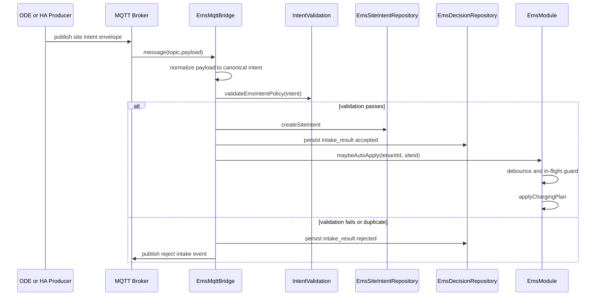
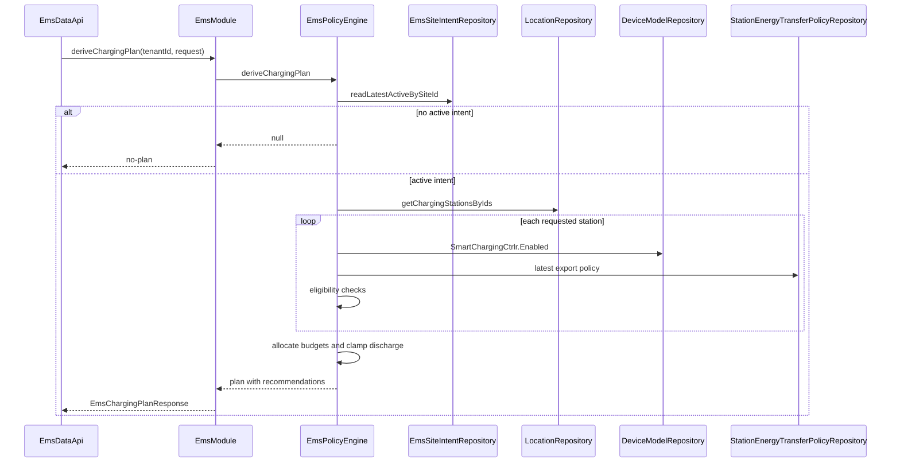
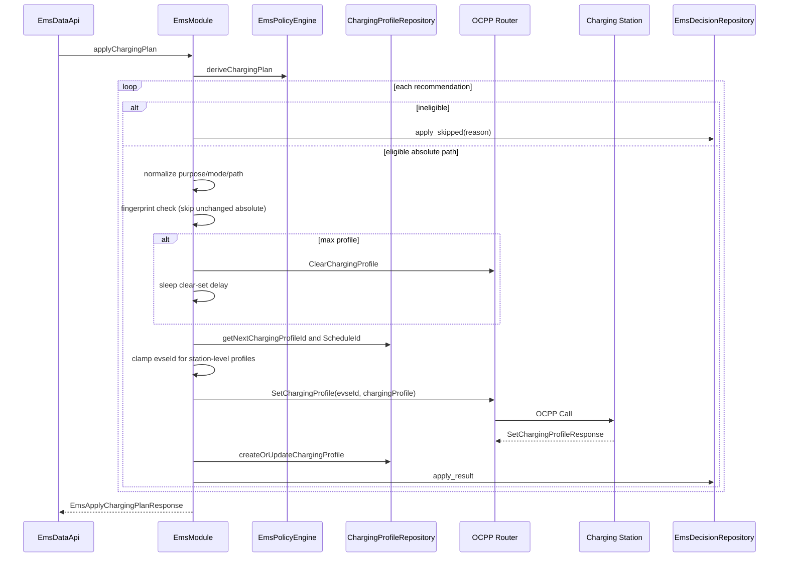
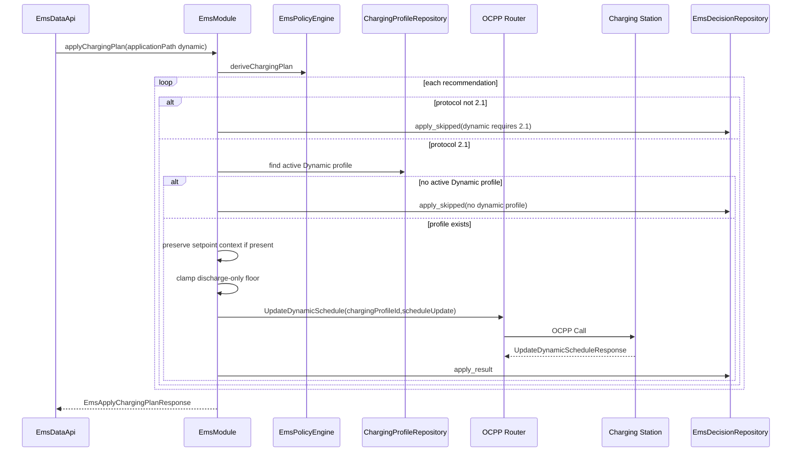
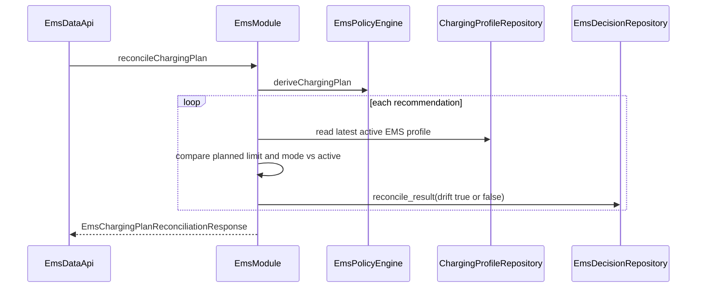

# EMS Sequence Diagrams

This document describes runtime call flow for the two core SmartCharging application paths and reconciliation.

Related docs:

- [Control Model Draft](EMS-CONTROL-MODEL-DRAFT.md)
- [Implementation Checklist](EMS-IMPLEMENTATION-CHECKLIST.md)
- [Clamp Test Matrix](EMS-CLAMP-TEST-MATRIX.md)

## 1) Intake + Auto-Apply (MQTT)

## 2) Derive Plan (Read-only Policy)

## 3) Apply Plan (Absolute Path)

## 4) Apply Plan (Dynamic Path)

## 5) Reconcile Plan

